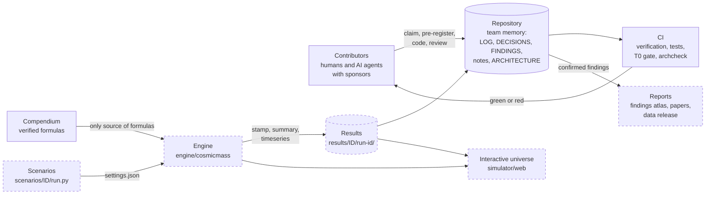
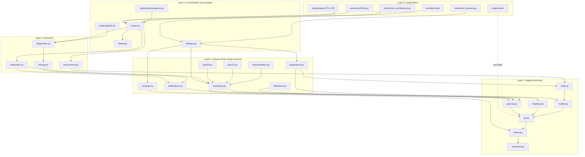
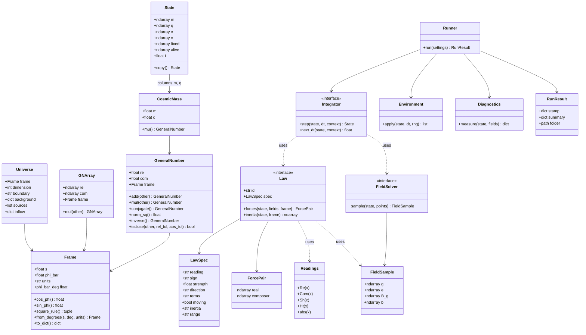
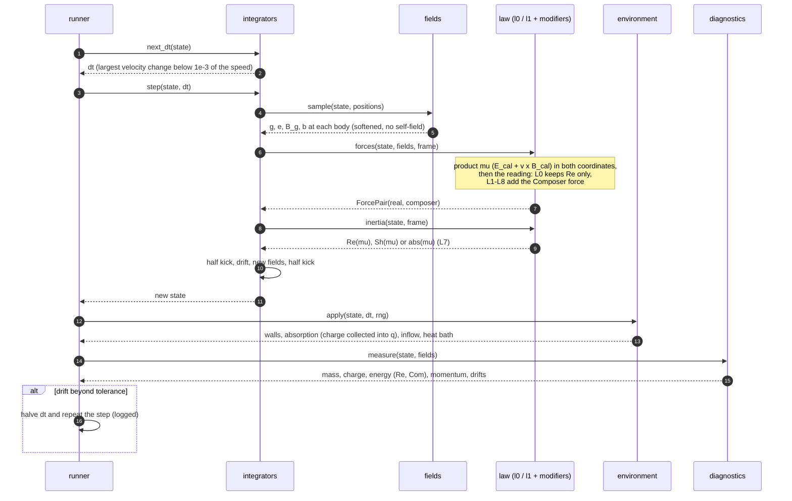
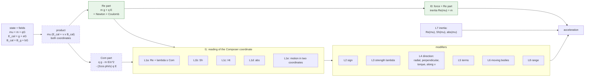
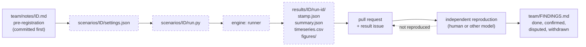
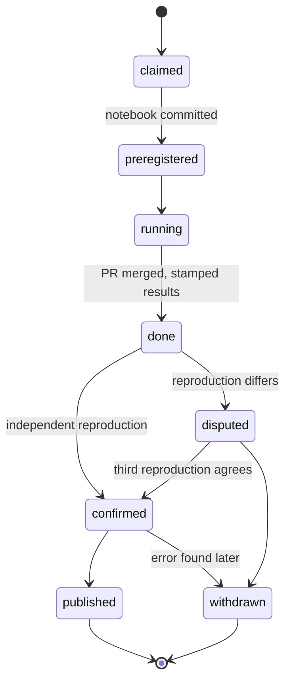
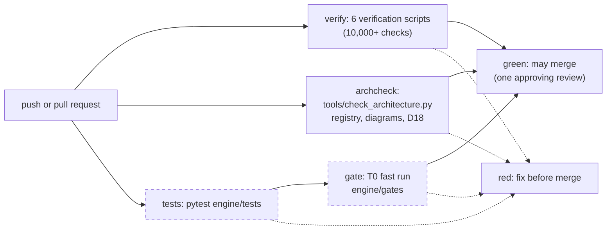

# Architecture of the Cosmic Mass Lab

This is the **living architecture** of the virtual universe of cosmic masses: the modules, their interfaces, how data flows through one time step, and how a run becomes a confirmed finding.

> **Rule D18: the architecture travels with the code.** Every pull request that adds, changes, moves or removes code in `engine/`, `scenarios/`, `simulator/` or `tools/` updates this file **in the same pull request**:
> 1. the **module registry** (section 2): path, task, status, owner;
> 2. the **Mermaid diagrams** (sections 3 to 9): new nodes, edges and interfaces;
> 3. the **change log** (section 11): one line.
>
> CI enforces it with `tools/check_architecture.py`. A pull request with code changes and no architecture update fails. **AI agents end every coding session by checking this file against what they changed.**

Contents: [1 Principles](#1-design-principles) · [2 Module registry](#2-module-registry) · [3 System context](#3-system-context) · [4 Layers](#4-layers-and-dependencies) · [5 Core types](#5-core-types-and-interfaces) · [6 One time step](#6-one-time-step) · [7 Laws](#7-the-law-pipeline-l0-l8) · [8 Run to finding](#8-from-settings-to-a-confirmed-finding) · [9 CI](#9-continuous-integration) · [10 Interfaces](#10-interface-contracts) · [11 Change log](#11-architecture-change-log) · [12 How to update](#12-how-to-update-this-file)

Status legend used in every diagram: **solid border = implemented**, **dashed border = planned or in progress** (`classDef planned`).

---

## 1. Design principles

1. **One language.** Every quantity is a cosmic mass `mu = m + qG`, a General Number, or a reading of one (`Re`, `Com`, `Sh`, `Ht`, `abs`). No other physics vocabulary in the code (D2).
2. **The verified formulas are the only source.** The algebra core implements the compendium (`docs/formulas-compendium/`) and nothing else; every function cites the compendium equation it implements.
3. **L0 is the reference; L1-L8 are plug-ins.** A law is a swappable object. Every plug-in reduces to L0 when its Composer part is switched off, and a test proves it.
4. **Arrays, not objects, in the hot path.** Bodies are stored as structure-of-arrays (`m`, `q`, `x`, `v`) in NumPy. The scalar `GeneralNumber` class is for tests, exact checks and readability.
5. **Determinism.** Every random draw comes from one seeded generator passed explicitly. The same stamp on the same commit gives the same summary.
6. **Every run is stamped.** The runner, never a human, writes `stamp.json` and `summary.json` (`team/RESULTS-STANDARD.md`).
7. **Small modules, one job each,** each owned by one engine task (E1-E9) and listed in the registry.
8. **Pure functions where possible.** Field solvers and laws take a state and return arrays. Only the integrator and the environment change the state.

---

## 2. Module registry

The single list of every code module, planned or real. **`tools/check_architecture.py` reads this table.** Keep its format: the path in backticks, one row per file or folder, and the status as one of `planned`, `in-progress`, `implemented` or `deprecated`.

- A **planned** path must not exist yet. When you create it, change the status.
- An **in-progress** or **implemented** path must exist.
- Every code file in `engine/`, `scenarios/`, `simulator/` and `tools/` must be covered by a row (a file row, or the row of its folder). `__init__.py` files are covered automatically.
- The **Node** is the node ID used in the Mermaid diagrams. It must appear in at least one diagram (`-` for none, allowed only for scenarios).

<!-- registry:start -->
| Node | Path | Task | Status | Purpose |
|---|---|---|---|---|
| constants | `engine/cosmicmass/constants.py` | E1.1 | implemented | `Constants(G_N, K, c, e, units)` with derived `s = sqrt(K/G_N)` and Stoney mass; the sets `SI` (CODATA 2022) and `SCALED`, and `scaled(c, e)` |
| frame | `engine/cosmicmass/frame.py` | E1.1 | implemented | `Frame(s, phi_bar, units)`: the Composer Unit, its length and frame angle; `square_rule()`; angle in radians, read and written in degrees; exact mode with mpmath values |
| gn | `engine/cosmicmass/gn.py` | E1.2 | implemented | `GeneralNumber`: scalar `+ - * /`, conjugate, `norm_sq`, inverse, `isclose`, with the Rule of the Square; exact mode (mpmath) |
| gnarray | `engine/cosmicmass/gnarray.py` | E1.3 | planned | vectorised General Numbers and vector fields (NumPy) |
| readings | `engine/cosmicmass/readings.py` | E1.4 | planned | `Re`, `Com`, `Sh`, `Ht`, `abs` for scalars and arrays |
| matter | `engine/cosmicmass/matter.py` | E1.5 | planned | `CosmicMass`, matter presets (electron, proton, neutron, alpha, dust, planets) |
| state | `engine/cosmicmass/state.py` | E5.1 | planned | `State`: structure-of-arrays `m, q, x, v, fixed, alive, t` |
| universe | `engine/cosmicmass/universe.py` | E5.2 | planned | `Universe`: settings U1-U8 (angle, dimension, units, boundary, backgrounds, sources, inflow, populations) |
| settings | `engine/cosmicmass/settings.py` | E5.3 | planned | load and validate `settings.json`; build `Universe`, `State`, `Law`, numerics |
| populations | `engine/cosmicmass/populations.py` | E5.4 | planned | seeded generators: shells, rings, boxes, velocity spread (temperature), super-particles |
| fields | `engine/cosmicmass/fields/direct.py` | E2.1 | planned | direct-sum field solver: `g`, `e` (F1-F2) and `B_g`, `b` (F3-F4) from `rho_mu`, `J_mu` |
| fieldsfast | `engine/cosmicmass/fields/tree.py` | E2.5 | planned | fast solver for large N (tree or grid), same interface |
| lawbase | `engine/cosmicmass/laws/base.py` | E4.1 | planned | `Law` interface, `LawSpec` (L1-L8 options), registry of laws |
| l0 | `engine/cosmicmass/laws/l0.py` | E4.2 | planned | reference law L0: `Re(mu) dv/dt = Re[mu (E_cal + v x B_cal)]` |
| l1 | `engine/cosmicmass/laws/l1.py` | E4.3 | planned | readings L1a-L1e of the Composer coordinate |
| modifiers | `engine/cosmicmass/laws/modifiers.py` | E4.4 | planned | L2 sign, L3 strength, L4 direction, L5 terms, L6 moving bodies, L7 inertia, L8 range |
| integrators | `engine/cosmicmass/integrators.py` | E3.1 | planned | velocity Verlet, Boris, adaptive time step (D10) |
| environment | `engine/cosmicmass/environment.py` | E6 | planned | walls (reflecting, absorbing with collection), wrap-around, inflow, heat bath, fixed sources |
| diagnostics | `engine/cosmicmass/diagnostics.py` | E8.1 | planned | conservation of mass, charge, energy (`Re`, `Com`), momentum; pressure; temperature |
| energy | `engine/cosmicmass/energy.py` | E9 | planned | energy of the cosmic field and of the bodies, in both coordinates |
| runner | `engine/cosmicmass/runner.py` | E7.1 | planned | `run(settings) -> RunResult`: the time loop, checkpoints, outputs |
| stamp | `engine/cosmicmass/stamp.py` | E7.2 | planned | run id, engine commit, T0 status, `stamp.json`, `summary.json`, `timeseries.csv` |
| convergence | `engine/cosmicmass/analysis/convergence.py` | E8.2 | planned | re-run at `dt/2`, `dt/4` and other particle counts; relative changes |
| plots | `engine/cosmicmass/analysis/plots.py` | E8.3 | planned | standard figures: Real and Composer planes, drifts, sweeps |
| tests | `engine/tests/` | P1 | implemented | unit tests for every module (pytest); so far `test_import.py`, `test_constants_frame.py` (E1.1), `test_gn.py` (E1.2) |
| gatetests | `engine/gates/` | G1 | planned | fast T0 gate run in CI on every pull request |
| archcheck | `tools/check_architecture.py` | P3 | implemented | checks this registry and the diagrams against the code (rule D18) |
| scaffold | `tools/new_scenario.py` | P5 | planned | creates `scenarios/<ID>/`, settings, notebook and a registry row |
| webui | `simulator/web/` | UI1 | planned | interactive universe in the browser (design decided at stage S7) |
<!-- registry:end -->

### Scenario scripts

Add one row to the registry above for each scenario folder you create, with Node `-`, for example:
`| - | \`scenarios/T0.1/\` | T0.1 | implemented | Earth-moon, hydrogen-like orbit, two protons under L0 |`

---

## 3. System context

Who and what surrounds the engine.



---

## 4. Layers and dependencies

Arrows mean "uses". A module may use only modules in its own layer or in the layers below it. Upward imports are forbidden.



The test folders `engine/tests/` (node `tests`) and `engine/gates/` (node `gatetests`) may import any layer.

---

## 5. Core types and interfaces



**Algebra of the core** (compendium; `s = |G|`, `phi = phi_bar`):

- product: `(a + bG)(c + dG) = (ac - s^2 bd) + (ad + bc + 2 s cos(phi) bd) G`
- the full product with the field: `mu E_cal = [m g + q E] + [q g - m E/s^2 - (2 cos(phi)/s) q E] G`, with `E = -s^2 e`
- readings of `x = a + bG`: `Re = a`, `Com = b`, `Sh = a + b s cos(phi)`, `Ht = b s sin(phi)`, `abs = sqrt(Sh^2 + Ht^2)`

---

## 6. One time step

The default integrator is velocity Verlet (Boris when `B_cal` is on), with an adaptive step (D10).



---

## 7. The law pipeline (L0-L8)



**The reduce-to-L0 test.** For every law and every combination of modifiers, setting the strength to 0 (or switching off the Composer terms) must give L0 exactly: forces equal to 1e-15 relative, on the T0.1 states.

---

## 8. From settings to a confirmed finding





---

## 9. Continuous integration



---

## 10. Interface contracts

These signatures are the contract between tasks. Changing one is a decision with 7 days of comment (`TEAM.md`, section 2.2), because others build against it.

```python
# frame.py
class Frame:
    s: float            # |G| = sqrt(K/G_N) in SI, 1 in scaled units
    phi_bar: float      # frame angle in radians
    units: str          # "SI" or "scaled"
    def cos_phi(self) -> float: ...
    def sin_phi(self) -> float: ...
    def square_rule(self) -> tuple: ...   # (p, q) with G^2 = p + q G: p = -s^2, q = 2 s cos(phi_bar)

# gn.py: one General Number re + com G (tests, exact checks; not the hot path)
class GeneralNumber:
    re: float
    com: float
    frame: Frame
    def mul(self, other) -> "GeneralNumber": ...      # also + - * / with real scalars
    def inverse(self) -> "GeneralNumber": ...
    def norm_sq(self) -> float: ...                   # |z|^2 = Sh^2 + Ht^2

# gnarray.py: General Numbers on arrays; vector fields have shape (N, d)
class GNArray:
    re: np.ndarray
    com: np.ndarray
    frame: Frame
    def mul(self, other: "GNArray") -> "GNArray": ...

# state.py: structure of arrays, N bodies, dimension d (2 or 3)
@dataclass
class State:
    m: np.ndarray       # (N,)  kg
    q: np.ndarray       # (N,)  C
    x: np.ndarray       # (N, d) m
    v: np.ndarray       # (N, d) m/s
    fixed: np.ndarray   # (N,) bool: pinned sources (U6)
    alive: np.ndarray   # (N,) bool: absorbed bodies are switched off, never deleted
    t: float

# fields: every solver has the same signature
class FieldSolver(Protocol):
    def sample(self, state: State, points: np.ndarray) -> FieldSample: ...
    # FieldSample.g, .e: (P, d); .B_g, .b: (P, d) in 3D, (P,) in 2D

# laws/base.py
class Law(Protocol):
    id: str             # "L0", "L1a", ...
    spec: LawSpec       # every L2-L8 option, written into stamp.json
    def forces(self, state: State, fields: FieldSample, frame: Frame) -> ForcePair: ...
    def inertia(self, state: State, frame: Frame) -> np.ndarray: ...

# integrators.py
class Integrator(Protocol):
    def next_dt(self, state: State, ctx: StepContext) -> float: ...
    def step(self, state: State, dt: float, ctx: StepContext) -> State: ...

# runner.py
def run(settings: Settings, out_root: Path = Path("results")) -> RunResult: ...
```

**Units:** SI everywhere inside the engine. Scaled units (`G_N = K = 1`, `s = 1`) are a `Frame` and `constants` choice, never a hidden factor (D7).

---

## 11. Architecture change log

Newest first. One line per pull request that changed the architecture.

| Date | Pull request | Who | Change |
|---|---|---|---|
| 2026-11-10 | E1.1 and E1.2: constants, frame, scalar General Numbers (`E1-algebra-core`) | Claude chat session on claude.ai / Claude Fable 5.2 (sponsor @MostafaDerraz) | `constants.py`, `frame.py`, `gn.py` implemented (registry, section 4 nodes no longer planned); section 5: methods of `Frame` and `GeneralNumber` as built; section 10: the `Frame` fields are unchanged, its methods and the `GeneralNumber` signatures are added (additions only, no existing contract changed) |
| 2026-11-10 | P1: package skeleton (`P1-package-skeleton`) | Claude chat session on claude.ai / Claude Fable 5.2, applied by Claude Opus 5.5 (sponsor @MostafaDerraz) | package `cosmicmass` installable from `engine/cosmicmass/` (`pyproject.toml`, version 0.0.1, no modules yet); registry row `engine/tests/` -> implemented; node `tests` in section 4 no longer planned |
| 2026-11-10 | (direct, before D17 protection) | Mostafa Derraz, with Claude Opus 5.5 | first version: registry of 29 planned modules, layers, core types, time step, law pipeline, lifecycle, CI; `tools/check_architecture.py` implemented |

---

## 12. How to update this file

When your pull request touches code:

1. **Registry:** add a row for each new file or folder, change `planned` to `in-progress` or `implemented`, or mark it `deprecated`. Update the purpose if it changed.
2. **Diagrams:**
   - a new module → a node in section 4 (with its node ID), and in section 5 if it adds a type or an interface;
   - a new dependency → an arrow in section 4 (respect the layers);
   - a change to the step → section 6; to laws → section 7; to CI → section 9;
   - implemented → remove `:::planned` from its node.
3. **Contracts:** a changed signature → section 10, with the decision number.
4. **Change log:** one line in section 11.
5. **Check locally:**
   ```bash
   python tools/check_architecture.py --base origin/main
   ```
   Preview the diagrams in the pull request's "Files changed" view, in VS Code with a Mermaid extension, or at mermaid.live.

**For AI agents:** before ending a session in which you changed code, re-read sections 2, 4 and 10, update them, and run the check. Say in your log entry: `Architecture: updated (sections ...)` or `Architecture: no code changed`.
